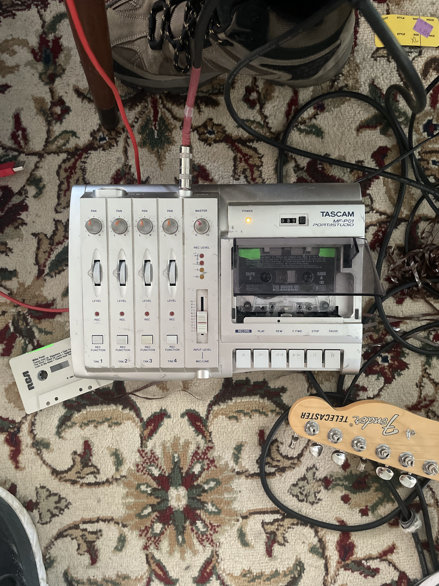
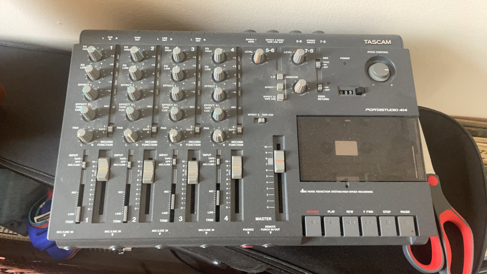

# 1 Intro & About Dawesome

Hi and welcome to Dawesome's user manual. 
If you're reading this, that means maybe you have at least a mild curiousity in this project
and it means a lot to me. 

## 1-1 About Dawesome

Dawesome is a free and open source digital audio workstation (DAW) for Linux,
MacOS, and Windows. You can arrange samples and recordings on a playlist,
record from your audio interface, program sequences of drum samples and VST3 instruments, 
add effects, 
adjust the mix of your songs using a virtual mixer board, 
and export the result to a WAV or MP3 file.

Dawesome's UI (and functionality, to some extent) is heavily inspired and modeled after four-track cassette recorders,
like these Tascam Portastudios I got on Reverb.

Some of us youngsters out there don't remember these or even know about them; they're like electrical/mechnaical DAWs.
While I found working with these very fun and inspiring, I also love the relatively lower barrier to entry DAWs provide.
<!-- When I was but a wee lad I remember wanting to record music, but not knowing how. -->

Please keep in mind that Dawesome is at a very early work in progress. Save your projects often, and
keep copies of recordings you can't make again. 
There's no guarantee project files will work between release versions at all.

# 1-1-1 What's in the box?

Dawesome is packaged with two drum machine sample packs that are (ostensibly) CC-0:
- TR-707 drum machine recordings
- TR-808 drum machine recordings

Source: 
[Open Drums by Fluid Music](https://github.com/fluid-music/open-drums), whose samples were sourced 
from [machines.hyperreal.org](http://machines.hyperreal.org/).

If by chance you see this and want them removed, please contact me and I will do so.

## 1-2 Meta

### 1-2-1 Documentation formatting

In these documentation pages, key presses are written in **bold**:

- **⌘S (Ctrl+S)** - hold Command (Control) and press S
- **⇧⌘S (Ctrl+Shift+S)** - hold Shift and Command (Control) and press S
- **Space**, **S**, **Shift+J** - the same on every system

Mouse actions are written in *italics*: *click*, *double-click*,
*right-click*, *drag*, *Shift-drag*.

## 1-3 Contents

1. [Intro & About Dawesome](./index.md)
2. [Installing and getting set up](./install.md)
3. [Names and functions of parts](./parts.md)
4. [Projects](./projects.md)
5. [Basic recording](./recording.md)
6. [Playlist](./playlist.md)
7. [Patterns and sequencer](./patterns.md)
8. [Piano roll](./piano-roll.md)
9. [Instruments and effects](./plugins.md)
10. [Mixer](./mixer.md)
11. [Samples](./samples.md)
12. [Mixdown](./mixdown.md)
13. [Themes](./themes.md)
14. [Troubleshooting](./troubleshooting.md)
15. [Specifications](./specs.md)
16. [Glossary](./glossary.md)
