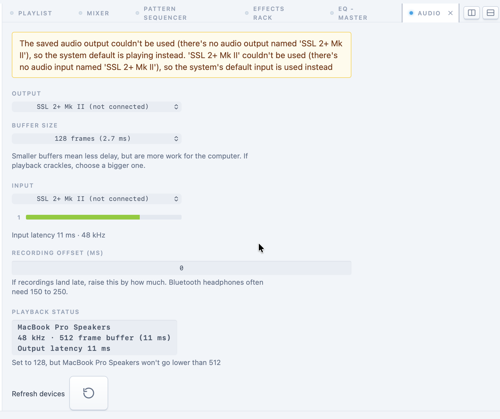
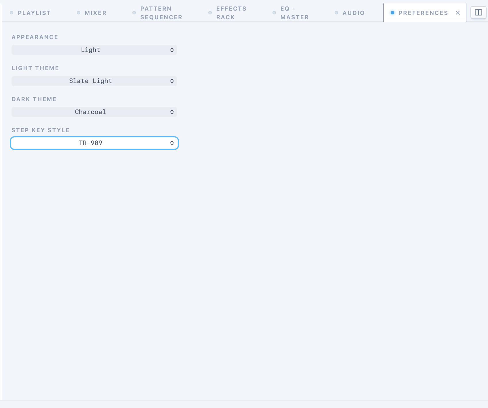

# 2 Installing and Getting Set Up

## 2-1 Installing

You can download and install Dawesome from [the GitHub's release page](https://github.com/nbennett320/dawesome/releases).
It should just like any other application. 

MacOS will flag Dawesome as unsigned. Get around this by entering the following in your terminal:

```bash
xattr -dr com.apple.quarantine /Applications/Dawesome.app
```

<!-- VERIFY: no release builds or installers exist on GitHub Releases at c2295cb. Replace this section with download and install steps per platform once they do. -->

## 2-2 First launch

When Dawesome starts, it opens one window with the **Playlist**, **Mixer**
and **Pattern Sequencer** tabs, and the sidebar open on the samples
browser. The window's title bar shows **Untitled — Dawesome** until you save
the project. See [Names and functions of parts](./parts.md).

Dawesome plays through your system's default output device at that device's
own sample rate. 
If you don't hear anything at first, you might need to
choose another audio device.
<!-- , or to record, set up the audio first ([2-3](#_2-3-audio-settings)). -->

<!-- VERIFY: whether the sidebar's samples browser has anything in it in a built app; it lists an `assets` folder relative to the app's working directory. -->

## 2-3 Audio settings

To open the audio settings, choose **Preferences ▸ Audio Settings**. They
open in a tab named **Audio**.



1. **Output** - The device Dawesome plays through. **System default** follows
   your system's choice. A device you chose that is unplugged stays in the
   list as "*name* (not connected)".
2. **Buffer size** - How much audio the output works on at a time: **Device
   default**, or 64, 128, 256, 512 or 1024 frames (the time each takes is
   shown next to it). Only sizes your device accepts are listed. Smaller
   buffers mean less delay but more work for the computer. If playback
   crackles, choose a bigger one.
3. **Input** - The device Dawesome records from. **System default** follows
   your system's choice.
4. Input meter - A level bar for each input channel, while the tab is
   showing. Use it to check that your input is arriving.
5. Input details - The input's latency and sample rate. When the input can't
   run at the output's rate, a note says that takes are converted.
6. **Recording offset (ms)** - Moves recordings earlier by this many
   milliseconds, from −1000 to 1000. If recordings land late, raise it by how
   much. Bluetooth headphones often need 150 to 250. A negative value moves
   them later.
7. **Playback Status** - The output device in use, its sample rate, its
   buffer and its output latency. If the device refused the buffer size you
   chose, a note says what it used instead.

Press the key beside **Refresh devices** to list the devices again, for
example after you plug in an interface.

Changes apply as soon as you make them. **Switching...** shows while the audio
restarts.

::: warning CAUTION
Changing any audio setting stops any recording in progress and pauses
playback.
:::

### 2-3-1 Sample rate

There is no sample-rate setting. Dawesome runs at the output device's default
sample rate, shown under **Playback Status**. To change it, change the
device's rate in your system's audio settings (on a Mac, **Audio MIDI
Setup**), then restart Dawesome.

<!-- VERIFY: the output only reopens at launch or when the output device or buffer size changes; refresh only re-reads the device list. Confirm a restart is needed. -->

### 2-3-2 To set up an audio interface

1. Connect the interface and turn its outputs down (just in case - so you don't hurt your ears)
2. Choose **Preferences ▸ Audio Settings**
3. Choose the interface under **Output**, and again under **Input**
4. Watch the input meter while you make a sound into the input
5. If playback crackles, choose a bigger **Buffer size**

## 2-4 Preferences

To open the preferences, choose **Dawesome ▸ Preferences** (**⌘, (Ctrl+,)**)
or **Preferences ▸ Appearance**. Both open the **Preferences** tab. Changes
apply as you make them.



1. **Appearance** - **System** follows your system's light or dark mode.
   **Light** and **Dark** keep Dawesome in one mode.
2. **Light theme** - The colors used in light mode. A few themes come stock (just take a look at the gallery).
**Slate Light** is the default.
3. **Dark theme** - The colors used in dark mode. **Charcoal** is the default.
4. **Step key style** - The drum sequencer is modeled after Roland analog drum machine step sequencers.
The [TR-909](https://en.wikipedia.org/wiki/Roland_TR-909) is the default style, but a few others come stock.

For more about themes, see [Themes](./themes.md).

### Controls

Choose **Preferences ▸ Controls** to open the **Controls** tab.

<!-- PROVISIONAL -->
1. **Plugins open** - Where a plugin's own interface opens: **In a window of
   their own** (default) or **In a tab**. See [Instruments and
   effects](./plugins.md).
2. **Command bar** - Off by default. When it's on, type **:** (outside a
   text field) to open a [Vim](https://en.wikipedia.org/wiki/Vim_(text_editor))-style command line in the info bar along the
   bottom of the window. You can switch tabs and issue various commands this way. See [Command bar](../shortcuts.md#command-bar) for
   what's available.

## 2-5 Where settings are kept

Dawesome keeps its settings in a `dawesome` folder inside your system's
settings folder. They are kept between launches and are not part of any
project.

| File | Holds |
| --- | --- |
| `audio-settings.json` | Output, input, buffer size and recording offset |
| `preferences.json` | Appearance, themes and where plugins open |
| `recent-projects.json` | The **File ▸ Open Recent** list |
| `plugins.json` | The plugins found by the last scan <!-- PROVISIONAL --> |

The settings folder is:

- macOS: `~/Library/Application Support/dawesome/`
- Windows: `%APPDATA%\dawesome\`
- Linux: `~/.config/dawesome/`

<!-- VERIFY: Windows and Linux paths (from the `dirs` crate's config_dir; only the macOS path is given in the code). -->

Recordings made before a project is first saved are kept in a `dawesome/unsaved`
folder inside your system's application data folder (on macOS, the same
`~/Library/Application Support/dawesome/`). See [Projects](./projects.md).

::: tip NOTE
A missing or damaged settings file is replaced by the defaults. To reset a
setting, quit Dawesome and delete its file.
:::

<!-- VERIFY: deleting a settings file resets it (the code loads defaults for a missing file; check nothing else breaks, e.g. plugins.json triggers a fresh scan). -->
